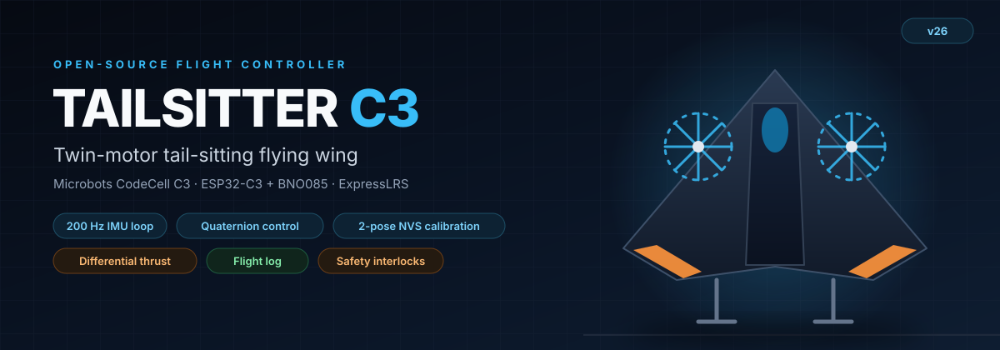
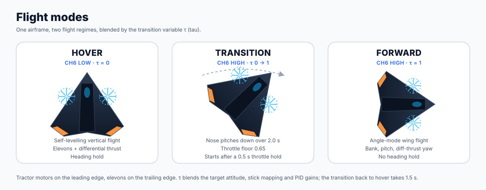
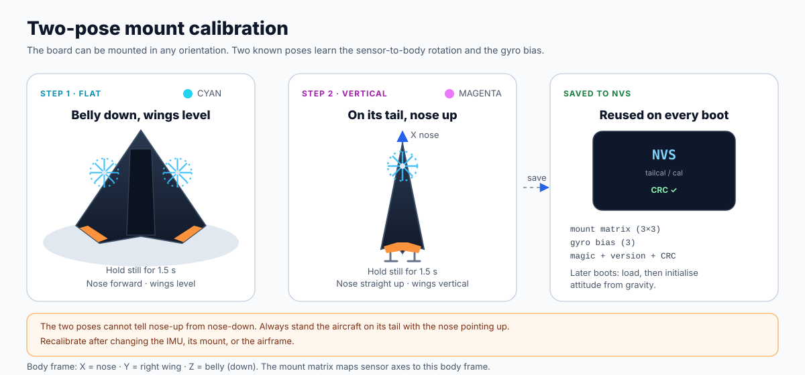
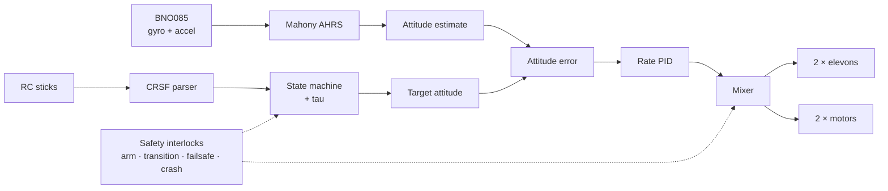

<div align="center">
  
</div>

# TailSitter C3

**A twin-motor tail-sitting flying wing that takes off vertically, hovers, pitches into forward flight, and comes back — on a Microbots CodeCell C3.**

[](docs/HARDWARE.md)
[](docs/ARCHITECTURE.md)
[](docs/FLIGHT.md)
[](TailSitter.ino)
[](LICENSE)

> [!WARNING]
> **Remove both propellers for all bench testing.** This sketch commands two ESCs and two servos. Treat the aircraft as loaded whenever the battery is connected.

## Why this exists

Most small flying wings need a launch — a hill, a hand, or a bungee. A tail-sitter doesn't. It stands on its tail, lifts off vertically, and then pitches forward into normal wing-borne flight. The same airframe can hover in a garden, transition to forward flight, and come back to a vertical landing.

The **Microbots CodeCell C3** is a natural fit: an ESP32-C3 and a BNO085 IMU on a board small enough for a foam wing. Two ESCs with BECs, two elevon servos, and an ExpressLRS receiver are all the hardware the controller needs. This sketch is the flight controller that ties them together.

The goal is not to be a general-purpose autopilot. It is a small, readable, single-file flight controller that does one job well: **hover → transition → fly → transition → hover**, with the safety checks that a tail-sitter needs.

## What it does

- **Vertical takeoff and hover** with self-levelling and heading hold.
- **One-switch transition** (CH6) from hover to forward flight in 2.0 s, and back in 1.5 s.
- **Quaternion attitude control in the body frame** — no gimbal lock at 90° nose-up, which is exactly where a tail-sitter lives.
- **200 Hz gyro loop** with a 100 Hz accelerometer and a Mahony complementary filter.
- **Two-pose mount calibration stored in NVS**, so the board can be mounted in any orientation and the aircraft boots calibrated in the field.
- **Differential thrust + elevons**, with a mixer that keeps the differential from stopping one motor instead of letting it drop toward stop.
- **Arming and transition interlocks**, failsafe, crash detection and IMU-loss disarm.
- **50 Hz onboard flight log** with CSV dump over USB — no SD card and no telemetry required.

<div align="center">
  
</div>

| Mode | CH6 | Pilot | Controller |
|---|---|---|---|
| **HOVER** | Low | Throttle for height, right stick to lean / rotate | Self-levelling vertical flight, heading hold, elevons + differential thrust |
| **TO_FWD** | High | Raise throttle above 0.30 and hold | Nose pitches down over 2.0 s, throttle floor 0.65, `tau` blends 0 → 1 |
| **FORWARD** | High | Bank / pitch / yaw | Angle-mode wing flight, no heading hold |
| **TO_HOVER** | Low | Centre the sticks | Nose pitches back up over 1.5 s, throttle floor 0.65 |
| **FAILSAFE** | — | Radio off | Forced back to hover, then a controlled descent; disarms after 15 s |

## Hardware at a glance

| Part | Notes |
|---|---|
| **Microbots CodeCell C3** | ESP32-C3 + BNO085. The only brain. Powered from a 5 V BEC, **not** its battery connector. |
| **2 × brushless motors + props** | Counter-rotating, **tractor-mounted on the leading edge (front) of each wing**. Differential thrust provides hover yaw / side-lean and forward yaw. |
| **2 × ESCs with BEC** | PWM, OneShot, Multishot or DShot. Use **one** BEC, or cut the red wire on the second ESC. |
| **2 × elevon servos** | **Elevons on the trailing edge (rear).** Left on IO6, right on IO7. |
| **Small flying wing airframe** | Any wing with two elevons, motors on the leading edge, and a roughly symmetric thrust line. |
| **ExpressLRS receiver** | CRSF at 420 kbaud. TX → IO1, RX → IO2 (optional). |
| **2S–4S pack** | Match the motors, ESCs and BEC. |

The pin map is fixed in the sketch:

| CodeCell pin | Function |
|---|---|
| IO1 | CRSF data in (receiver TX) |
| IO2 | CRSF data out (receiver RX, optional) |
| IO5 | Left ESC signal |
| IO3 | Right ESC signal |
| IO6 | Left elevon servo |
| IO7 | Right elevon servo |
| 5V / GND | From the ESC BEC / common ground |

Full wiring, power and airframe notes: **[docs/HARDWARE.md](docs/HARDWARE.md)**.

## Quick start

1. **Read [docs/SAFETY.md](docs/SAFETY.md).** Props off until the aircraft is ready to fly.
2. **Wire it** per [docs/HARDWARE.md](docs/HARDWARE.md). One BEC, common ground, receiver on IO1.
3. **Set up the Arduino IDE** per [docs/BUILD.md](docs/BUILD.md). Board: `ESP32C3 Dev Module`, partition: `Default 4MB with spiffs`.
4. **Set `ESC_PROTOCOL`** to match your ESCs (`0` PWM, `1` DShot, `3` OneShot125, etc.).
5. **Bench-test with props off:** `RX_TEST`, `HW_TEST`, `IMU_TEST` (see [docs/TROUBLESHOOTING.md](docs/TROUBLESHOOTING.md)).
6. **Calibrate the mount** per [docs/CALIBRATION.md](docs/CALIBRATION.md): flat on its belly, then on its tail with the nose up.
7. **Fly the first flight** as a test flight, per [docs/FLIGHT.md](docs/FLIGHT.md).

## Build settings

| Setting | Value |
|---|---|
| Board | **ESP32C3 Dev Module** |
| CPU frequency | 160 MHz |
| Flash size | 4 MB |
| Partition scheme | **Default 4MB with spiffs** (required for the flight log) |
| USB CDC On Boot | **Enabled** |
| Core debug level | None |
| Library | **CodeCell** (Library Manager) |
| Optional library | `CRSFforArduino` only if `CRSF_LIB 1` (the default built-in parser is recommended) |

The sketch is a single `.ino` file and compiles for `esp32:esp32:esp32c3`. It has been compile-checked with `DEBUG 0/1`, `IMU_DRIVER 0/1`, `LOG_ENABLE 0/1`, `CAL_FORCE 0/1`, and both analog and DShot ESC protocols.

## How the control works

<div align="center">
  
</div>

The controller works in the **aircraft body frame**, not in a fixed board frame:

| Body axis | Points | Drives |
|---|---|---|
| **X** | Nose | Elevon differential (forward roll / hover yaw) |
| **Y** | Right wing | Elevon collective (forward pitch / hover pitch) |
| **Z** | Belly | Differential thrust (forward yaw / hover side-lean) |

A transition variable `tau` blends the target attitude, stick mapping and PID gains between hover (`tau = 0`) and forward flight (`tau = 1`). Because the target is built as a quaternion, there is no singularity at 90°.

The mount calibration learns the rotation from the BNO085's sensor axes to this body frame. It is stored in NVS with a magic number, version and CRC, so a corrupt or interrupted write is rejected instead of producing a silently wrong attitude. On later boots the aircraft only needs to be **stationary**; it can be held in any attitude.



More detail: **[docs/ARCHITECTURE.md](docs/ARCHITECTURE.md)**.

## Documentation

| Document | What it covers |
|---|---|
| [docs/HARDWARE.md](docs/HARDWARE.md) | BOM, pin map, wiring, power, BEC sizing, airframe notes |
| [docs/BUILD.md](docs/BUILD.md) | Arduino IDE settings, libraries, build flags, upload |
| [docs/CALIBRATION.md](docs/CALIBRATION.md) | Two-pose procedure, NVS, serial commands, validation |
| [docs/FLIGHT.md](docs/FLIGHT.md) | Radio setup, preflight, arm, hover, transition, landing, failsafe |
| [docs/ARCHITECTURE.md](docs/ARCHITECTURE.md) | Body frame, quaternion control, tau blend, state machine, mixer |
| [docs/TUNING.md](docs/TUNING.md) | Servo directions, mixes, gains, transition constants |
| [docs/FLIGHT_LOG.md](docs/FLIGHT_LOG.md) | Log format, USB commands, CSV columns, analysis |
| [docs/SAFETY.md](docs/SAFETY.md) | Hard rules, interlocks, residual risks, first-flight protocol |
| [docs/TROUBLESHOOTING.md](docs/TROUBLESHOOTING.md) | Symptoms, causes and fixes |
| [TailSitter_REVIEW.md](TailSitter_REVIEW.md) | Full engineering review, patch history and verification notes |

## Repository layout

```
TailSitter/
├── TailSitter.ino            # the flight controller (v26)
├── TailSitter_REVIEW.md      # engineering review and patch history
├── README.md
├── LICENSE
├── assets/                   # SVG diagrams and the hero banner
├── docs/                     # hardware, build, calibration, flight, tuning, safety
├── other/                    # build photos and reference material
└── versions/                 # archived sketch versions
```

## Design notes

- **The mixer never stops one motor to yaw in hover.** The differential is clipped to the room between the collective and both rails, so when the collective is at or above the floor both motors stay in `[floor, 1]`. Below the floor the differential is removed and the motors stay equal. This was the one CRITICAL finding in the engineering review, and it is verified by an exhaustive sweep.
- **The two-pose calibration is persistent.** The mount matrix and gyro bias are saved to NVS, so a field boot does not need a flat/vertical reference — only a stationary aircraft.
- **The flight log is onboard.** 64-byte records at 50 Hz go to the `spiffs` partition and survive power-off. After landing, connect USB and type `dump` to get CSV.
- **Safety is layered.** Arming requires a still aircraft and a trusted attitude estimate. The forward transition requires a settled aircraft and a sustained throttle. Failsafe (after its timeout), crash detection and IMU-loss all disarm the motors.

## Safety and limits

- **Props off** for all bench work. No exceptions.
- Configure the ELRS receiver failsafe to **no pulses**. A receiver that holds stale channel values can defeat the link-loss detector.
- Use **one BEC**, or cut the red wire on the second ESC. Parallel BECs can fight.
- The two-pose calibration **cannot distinguish nose-up from nose-down**. Always stand the aircraft on its tail with the nose pointing up. See [docs/SAFETY.md](docs/SAFETY.md).
- The 15 s failsafe timeout is a deliberate trade-off. There is no altitude or airspeed sensing.
- This is a hobby flight controller, not a certified aviation system. Use at your own risk.

## License

[MIT](LICENSE) © 2026 TailSitter C3 contributors.

## Acknowledgements

Microbots for the CodeCell C3, the ExpressLRS project for the radio link, and the Arduino/ESP32, BLHeli/Bluejay/AM32 and Betaflight/INAV communities for the tools and conventions this project borrows from.
