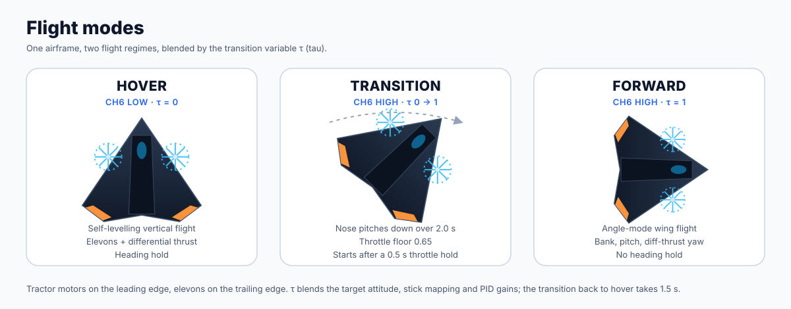
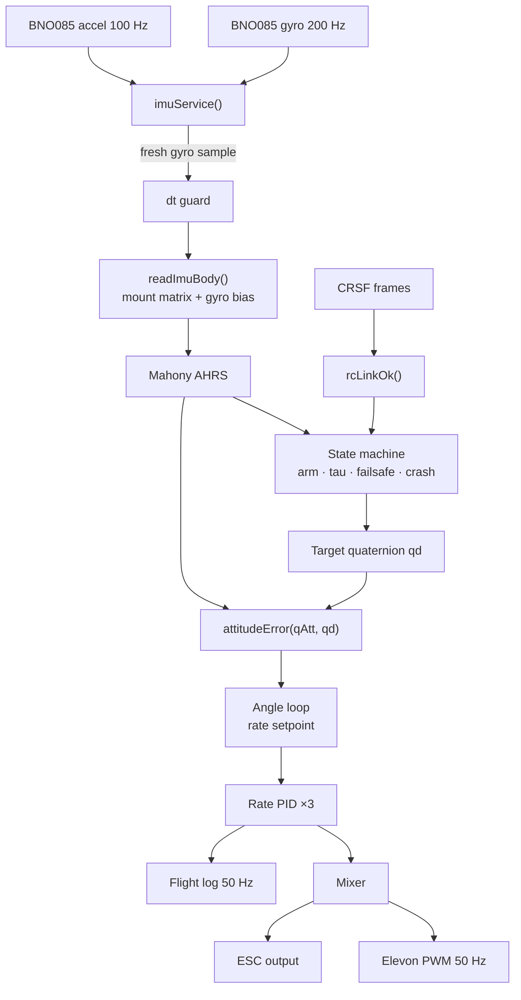
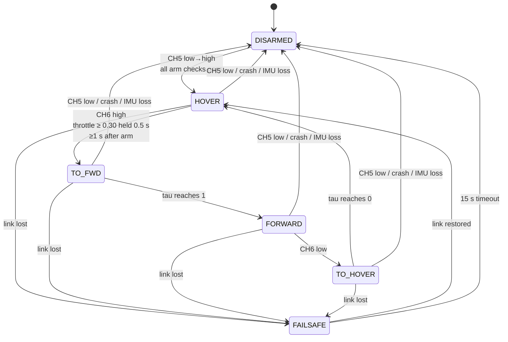

# Architecture

The controller is a single-file, bare-metal Arduino sketch. There is no RTOS task, no dynamic flight model and no companion computer. One loop runs once per fresh gyro sample, and everything — attitude, control, mixing, logging — happens inside it.

<div align="center">
  
</div>

## Control flow



## Body frame

All control is in the aircraft body frame, not the board frame:

| Axis | Direction | Positive command | Primary output |
|---|---|---|---|
| **X** | Nose | Roll right / yaw right in hover | Elevon differential |
| **Y** | Right wing | Pitch up | Elevon collective |
| **Z** | Belly | Yaw left / lean left in hover | Differential thrust |

The mount matrix `MNT` maps sensor axes to body axes. It is learned once by the two-pose calibration and stored in NVS. Every gyro and accel sample is multiplied by `MNT` before it reaches the estimator or the controller, so the board can be mounted in any orientation.

## Attitude estimation

The estimator is a Mahony complementary filter:

1. Normalise the accelerometer vector to get measured “up” in body coordinates.
2. Compare it with the estimated “up” from the current quaternion.
3. Add a proportional correction to the gyro rate.
4. Integrate the corrected rate into the quaternion.
5. Normalise the quaternion.

The accel correction is weighted by `ahrsTrust`, computed from how close the accelerometer magnitude is to 1 g:

```text
trust = 1 - | |a| - g | / (0.25 g)
```

Trust is clamped to 0..1. In high acceleration or free fall the accelerometer is ignored and the gyro carries the estimate. The current trust is logged and is also an arming condition (`ahrsTrust ≥ 0.5`).

There is **no magnetometer**. Heading is relative and may drift slowly. That is acceptable for heading hold and for the transition, but it is not a compass.

At boot with a saved calibration, attitude is initialised from gravity with `qFromTwoVectors()`, then refined with a high gain (`AHRS_KP_INIT 10`) while the aircraft is still. This is what allows a field boot in any attitude.

## Target attitude

The target is built as a quaternion, so there is no gimbal lock at 90° nose-up:

```text
qd = Yaw(headingTarget)
   * Pitch(pitchDeg)
   * Roll(bank)
   * BodyZ(lean)
```

with

```text
pitchDeg = lerp(90°, FWD_PITCH_DEG, tau)
         + pitchStick * lerp(HOVER_MAX_TILT_DEG, FWD_MAX_PITCH_DEG, tau)

bank     = rollStick * FWD_MAX_BANK_DEG * tau

lean     = rollStick * HOVER_MAX_TILT_DEG * (1 - tau)
```

| `tau` | Target nose | Roll input | Meaning |
|---|---|---|---|
| 0 | 90° above horizon | Body-Z lean, up to 15° | Hover |
| 0 → 1 | Blends 90° → 3° | Blends lean → bank, up to 45° | Transition |
| 1 | 3° above horizon | Bank, up to 45° | Forward flight |

Heading is handled differently in the two regimes:

- **Hover:** `headingTarget` is integrated from the yaw stick at up to 90 °/s. It is limited to 25° away from the actual heading, so a large yaw command cannot wind up a target the aircraft cannot reach. Heading is measured from the **belly** direction, because the nose points up.
- **Forward / transition:** heading is taken from the **nose** direction and there is no heading hold. The yaw stick adds a rate setpoint on body Z instead.

## Attitude error and rate loop

`attitudeError(qAtt, qd)` returns the body-frame rotation vector that takes the current attitude to the target. The magnitude is the angle; the direction is the axis. In hover, the body-Z component is scaled by `(1 - tau)` because the Z angle is only meaningful as a hover lean.

Each axis then runs:

```text
rateSp = constrain(angP * error, -maxRate, +maxRate)
u      = P*err + I*∫err - D*d(gyro)/dt
```

The gains are linearly blended between `G_HOVER` and `G_FWD` by `tau`. The integrator is clamped to `I_LIMIT` (0.40). The derivative term is low-pass filtered (`D_LPF` 0.25). Below `LANDED_THR` in hover the integrators are frozen, so a long descent does not wind them up.

The PID output is limited to −1..+1 per axis.

## Mixing

### Elevons

```text
outL = PITCH_MIX * u[1] - ROLL_MIX * u[0]
outR = PITCH_MIX * u[1] + ROLL_MIX * u[0]
```

- `u[0]` is body X: elevon differential (forward roll / hover yaw).
- `u[1]` is body Y: elevon collective (forward pitch / hover pitch).
- `ROLL_MIX` 0.6 and `PITCH_MIX` 0.8 set the relative authority.
- Positive collective moves both elevons **up**.
- `SERVO_REV_L` / `SERVO_REV_R` correct the physical servo direction.

### Motors

```text
d    = u[2] * DIFF_THRUST_MAX
base = throttle

room = min(1 - base, base - AIRMODE_MIN_THR)
room = max(room, 0)
d    = constrain(d, -room, +room)

mL = base + d
mR = base - d
```

`u[2]` is body Z: differential thrust. Positive Z makes the left motor faster.

This is the **mixer invariant**:

- When `base ≥ AIRMODE_MIN_THR`, `room ≥ 0`, so both motors stay within `[AIRMODE_MIN_THR, 1]`. The differential is clipped to whatever room exists, and the average thrust is unchanged because the command is symmetric.
- When `base < AIRMODE_MIN_THR`, `room = 0`, so the differential is removed and both motors run at the same low throttle. One motor is never driven toward stop while the other is at full.

The trade-off is deliberate: differential authority is reduced near the rails and removed below the floor. Keeping both motors alive matters more than maximum yaw authority at low throttle.

The mixer was verified by an exhaustive sweep of 4,004,001 `(base, d)` pairs in the engineering review. Non-finite inputs are replaced with 0 before the mixer and again in `motorCmd()` / `elevonUs()`.

### Output mapping

| Output | Analog protocols | DShot |
|---|---|---|
| Motor 0..1 | `MOTOR_IDLE_US` 1080 → `MOTOR_MAX_US` 2000 | `DSHOT_IDLE` 100 → `DSHOT_MAX` 2047 |
| Motor stop | 1000 µs | 0 |
| Elevon | `SERVO_CENTER` 1500 ± `SERVO_THROW_US` 400, clamped 1000–2000 | same |

Analog protocols scale the same 1000–2000 “µs” command to their own pulse width: OneShot125 125–250 µs, OneShot42 42–84 µs, Multishot 5–25 µs.

## State machine



### Arming

Arming is refused unless the throttle is low, CH6 is vertical, the aircraft is within 30° of upright, the gyro has been below 20 °/s for 100 ms, and the attitude estimate is trusted. Each refusal prints a reason in `DEBUG 1`. CH5 must be cycled low → high; there is one attempt per flick.

### Forward transition

The transition starts only after a 1 s settle delay after arming and a 0.5 s throttle hold at or above 0.30. The `tau` ramp rate is unchanged: 2.0 s forward, 1.5 s back. Once `tau > 0`, the transition continues even if the throttle drops, preserving the throttle floor.

### Failsafe

`rcLinkOk()` requires a valid frame within 250 ms, no receiver-reported failsafe, and link quality not equal to 0. On link loss:

- Enter `FAILSAFE`.
- Drive `tau` back to hover over 1.5 s.
- Hold throttle at 0.65 while `tau > 0`, then 0.48 in hover.
- Disarm after 15 s.

If the link returns, the state returns to `HOVER` and the pilot regains control. The transition hold is cleared, so a forward transition must be re-commanded.

### Crash detection

| Regime | Condition | Time |
|---|---|---|
| Hover (`tau = 0`) | Tilt from vertical > 70° | 1 s |
| Transition / forward (`tau > 0`) | Attitude error > 60° | 1 s |
| Any armed state | No fresh IMU sample for 200 ms | Immediate |

A crash disarm stops the motors. It does not level the aircraft.

## Timing

| Item | Rate / time |
|---|---|
| Control loop | One tick per fresh gyro sample, ~200 Hz |
| Gyro report interval | 5 ms |
| Accel report interval | 10 ms |
| Flight log | 50 Hz |
| Servo PWM | 50 Hz |
| OneShot125 ESC | 2 kHz |
| DShot keep-alive | 500 Hz |
| RC timeout | 250 ms |
| Receiver UART restart | 2 s with no bytes while disarmed |
| Calibration still time | 1.5 s per pose |
| Forward transition | 2.0 s |
| Back transition | 1.5 s |
| Failsafe timeout | 15 s |
| Crash confirmation | 1 s |
| IMU-loss disarm | 200 ms |

If a loop gap exceeds two control periods (for example after a flash write or a USB stall), the PIDs are reset and `dt` is clamped to one period. This prevents a derivative spike from a large gyro change divided by a tiny `dt`.

## Flight log

The log writes 64-byte packed records to the raw `spiffs` data partition at 50 Hz while armed. There is no file system: the partition is treated as a ring of records, pre-erased while disarmed so in-flight writes do not need an erase.

- Each arm starts a new session number.
- Each record has a magic number and an XOR checksum; invalid records are skipped on dump.
- Event records mark arm, disarm reason, failsafe and link restore.
- At 50 Hz the partition holds roughly 10 minutes of data.
- When full, recording stops and the LED warns at 95 %.
- Records survive power-off.

See [FLIGHT_LOG.md](FLIGHT_LOG.md) for the CSV columns and commands.

## Failure handling

| Failure | Response |
|---|---|
| BNO085 not found at boot | Fast red LED, motors off, halt. |
| No fresh IMU sample while armed | Disarm after 200 ms. |
| I2C error burst | Re-init the bus, increment `imuBusRecoveries`. |
| Loop gap > 2 periods | Reset PIDs, clamp `dt`. |
| Missing/corrupt calibration | Reject blob, run the two-pose calibration. |
| NVS save failure | Calibration applies to this power-up only; warning printed. |
| No log partition | Logging off, warning printed. |
| Log full | Recording stops, yellow LED warning. |
| RC link loss | Failsafe, then disarm after 15 s. |
| Non-finite control value | Replace with 0; equal motors / centred elevons. |
| Receiver sends no frames | UART restart every 2 s while disarmed. |

## Design trade-offs

- **Single IMU, single board.** No redundancy. The CodeCell is the flight controller, the IMU and the LED.
- **No magnetometer.** Heading drifts slowly; there is no absolute yaw.
- **No barometer, airspeed or GPS.** Failsafe and transition throttles are fixed fractions, not closed-loop height control.
- **No battery voltage sensing.** Low-battery protection is the pilot's responsibility.
- **Flash writes in the control loop.** The log is written from the same loop that flies the aircraft. The dt guard and PID reset mitigate a stall, but this remains a known residual risk in the engineering review.
- **Fixed 15 s failsafe timeout.** Long enough to recover a brief dropout, short enough to stop the motors after a real loss.
- **Analog or DShot ESCs.** Analog protocols need throttle calibration; DShot does not. The default is OneShot125.

---

Next: **[TUNING.md](TUNING.md)** · **[FLIGHT_LOG.md](FLIGHT_LOG.md)** · **[TailSitter_REVIEW.md](../TailSitter_REVIEW.md)**
