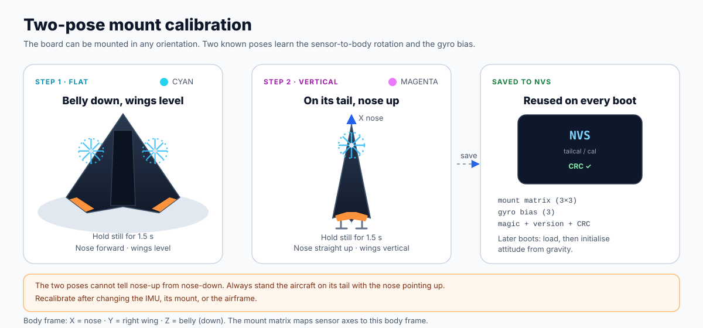

# Calibration

The CodeCell can be mounted in **any orientation** on the airframe. The controller does not assume the board is aligned with the wing. Instead, a two-pose calibration learns the rotation from the BNO085's sensor axes to the aircraft body frame, plus the gyro bias. The result is stored in NVS and reused on every later boot.

> [!WARNING]
> Remove both propellers. Calibration moves nothing, but the aircraft is powered and armed-capable afterwards.

## The body frame

| Body axis | Points | Drives |
|---|---|---|
| **X** | Nose | Elevon differential (forward roll / hover yaw) |
| **Y** | Right wing | Elevon collective (forward pitch / hover pitch) |
| **Z** | Belly (down when level) | Differential thrust (forward yaw / hover side-lean) |

The calibration produces a 3×3 matrix whose rows are the body X, Y and Z axes expressed in sensor coordinates. The flight code multiplies every sensor vector by that matrix, so the rest of the controller always sees a clean body frame.

<div align="center">
  
</div>

## Before you start

- **Props off.**
- The aircraft must be **still** during each pose. Hands off, not on a vibrating table.
- The radio does not need to be on for calibration, but it is useful to see the serial output.
- `LOG_ENABLE 1` (the default) is required for the serial `cal` commands. The LED sequence works regardless.
- Do the calibration on a level, stable surface. A wobbly bench adds gyro noise.

## First boot: the two poses

On the first boot, or after `cal erase`, the board runs calibration automatically.

### Step 1 — flat on the belly

1. Lay the aircraft **flat on its belly**, wings level, nose forward.
2. Keep it still. The LED blinks **fast cyan**.
3. After 1.5 s of stillness the pose is captured. The LED goes **solid cyan**.

The serial monitor prints:

```text
=== CALIBRATION ===
Step 1: lay the aircraft FLAT on its BELLY, wings level, hands off. (fast CYAN)
Step 1 captured (solid CYAN).
Step 2: stand the aircraft VERTICAL on its TAIL, nose up, hands off. (fast MAGENTA)
```

### Step 2 — on the tail, nose up

1. Rotate the aircraft to stand it **on its tail**, **nose straight up**, wings vertical.
2. The LED switches to **fast magenta** once you have rotated about 20° away from flat.
3. Keep it still. After 1.5 s of stillness the pose is captured. The LED goes **solid magenta** for 1.5 s.

The serial monitor prints the learned mount:

```text
Step 2 captured (solid MAGENTA). Angle flat->vertical 90 deg
  nose  = sensor +1.00 +0.00 +0.00
  right = sensor +0.00 +1.00 +0.00
  belly = sensor +0.00 +0.00 +1.00
  gyro bias 0.12 -0.08 0.05 dps, nose 90.0 deg above horizon, 0 IMU glitches
Calibration saved to NVS.
```

The exact numbers depend on how the board is mounted. What matters is:

- The **angle flat → vertical is at least 80°**. The controller will not capture the vertical pose until the two poses are far enough apart. A warning is printed below 85°.
- The three rows are unit length and roughly perpendicular.
- The gyro bias is small (a few degrees per second at most).
- The estimated nose is near **90°** at the vertical pose.

Then the LED settles into a **green blink**: ready and disarmed.

## What gets stored

The calibration is a versioned, CRC-checked blob in ESP32 NVS:

| Field | Value |
|---|---|
| Namespace | `tailcal` |
| Key | `cal` |
| Magic | `0x54414331` (`TAC1`) |
| Version | `1` |
| Contents | 3×3 mount matrix, 3-axis gyro bias, size, CRC32 |
| Force flag | key `force`, one-shot “calibrate at next boot” |

On load, the controller rejects the blob unless:

- The magic, version and size match.
- The CRC32 matches.
- Each mount row is unit length within 2 %.
- The rows are mutually orthogonal within 0.02.
- The determinant is at least 0.98 (a right-handed basis).
- The gyro bias is finite and below 0.5 rad/s (about 29 °/s).

A rejected blob is ignored, and the controller runs the two-pose calibration instead. It never silently uses a corrupt mount.

## Later boots

Once a valid blob exists, boot is simple:

1. Load the mount and gyro bias from NVS.
2. Read the accelerometer.
3. Initialise attitude from gravity — the aircraft can be held in **any** attitude.
4. Refine the estimate while the aircraft is still.
5. Green blink: ready.

No flat/vertical reference is needed in the field. The serial monitor prints:

```text
Saved calibration loaded - skipping the two-pose calibration.
```

The aircraft still needs to be **stationary at boot** for the attitude estimate to initialise cleanly. If it is moving, the accelerometer-derived initial attitude may be less accurate, but the filter converges once the aircraft is still; arming is refused until the gyro is still and the attitude is trusted.

## Serial commands

Open Serial Monitor at **115200**. Commands work **only while disarmed**.

| Command | Effect |
|---|---|
| `cal` | Run the two-pose calibration immediately, then save it. |
| `cal status` | Show the saved mount, gyro bias, version and force flag. |
| `cal force` | Set a one-shot flag: the **next boot** runs calibration and clears the flag. |
| `cal erase` | Delete the saved calibration and the force flag. The next boot calibrates. |
| `help` | List the log and calibration commands. |

`cal` is the fastest way to recalibrate on the bench: disarm, type `cal`, follow the LED.

`cal status` prints something like:

```text
Calibration: saved (version 1)
  nose  = sensor +1.00 +0.00 +0.00
  right = sensor +0.00 +1.00 +0.00
  belly = sensor +0.00 +0.00 +1.00
  gyro bias +0.12 -0.08 +0.05 dps
```

If nothing is saved:

```text
Calibration: none saved.
```

### `CAL_FORCE` versus `cal force`

- `CAL_FORCE 1` is a compile-time flag: calibrate at **every** boot. Use it during bench setup, then set it back to `0`.
- `cal force` is a one-shot NVS flag: calibrate at the **next** boot, then clear it. Useful when you do not want to recompile.

## When to recalibrate

Recalibrate after **any** of these:

- Moving the CodeCell to a different position or orientation.
- Replacing the IMU or the CodeCell.
- Changing the airframe, motor mounts or wing incidence in a way that changes the body axes.
- A hard crash or a board that came loose.
- `cal status` shows a mount that does not match the physical installation.
- The aircraft consistently drifts or pitches in a way that suggests the mount is wrong.

You do **not** need to recalibrate for a normal field boot, a battery change, or a new flying site.

## The nose-up / nose-down warning

The two poses constrain the mount but **cannot distinguish nose-up from nose-down** at the vertical pose. The accelerometer sees “up” along the aircraft's axis; it does not know which end is the nose. If you stand the aircraft on its tail with the nose pointing **down**, the learned “nose” axis is reversed, and the controller will fly with a mirrored attitude reference.

**Always stand the aircraft on its tail with the nose pointing up.** This is the single most important calibration rule.

Mitigations in the current firmware:

- The calibration requires at least 80° between the poses, so a lazy or rolled hold is rejected or warned about.
- The serial output prints the estimated nose angle; it should be about **+90°** at the vertical pose.
- After calibration, check the attitude in `DEBUG 1`: with the aircraft nose-up, `nose` should read near +90°, and with it level, near 0°.
- Recalibrate after any mount change.

A third pose or a magnetometer would resolve the ambiguity. Neither is implemented. See [SAFETY.md](SAFETY.md) for the residual risk.

## Validating a calibration

With **props off** and `DEBUG 1`:

1. Power the aircraft and let it settle. Confirm the green blink.
2. Hold it level, nose forward: `nose` should be near **0°**, `bank` near **0°**.
3. Stand it on its tail, nose up: `nose` should be near **+90°**.
4. Roll it right wing down: `bank` should move in the expected direction.
5. Rotate it about the vertical: heading should change smoothly, with no jumps.
6. Power-cycle. Confirm the saved calibration loads (no cyan/magenta sequence) and `cal status` shows the same mount.
7. Arm on the bench and confirm the arm checks pass with the aircraft still and upright.

If the nose reads **−90°** when the aircraft is nose-up, the vertical pose was captured nose-down. Recalibrate.

## Troubleshooting

| Symptom | Likely cause | Fix |
|---|---|---|
| Stuck on fast cyan | Aircraft is moving, vibrating, or the accel is out of range | Put it on a solid surface, hands off. Check `IMU_TEST 1`. |
| Never reaches fast magenta | You have not rotated far enough from flat (needs 20°) | Rotate to vertical; the LED changes once you are clearly away from flat. |
| Stuck on fast magenta | The pose is not within 80° of flat, or it is moving | Stand it fully on its tail, nose up, and hold still. |
| Warning: vertical pose captured at 8x° | The hold was rolled or leaning | Redo the calibration with the wings vertical. |
| `Calibration: none saved` after a good calibration | NVS write failed or was erased | Check the serial message; if it says it could not save, recalibrate. |
| Nose reads −90° when upright | Vertical pose captured nose-down | Recalibrate with the nose up. |
| Attitude drifts after boot | Aircraft was moving at boot, or the gyro bias is stale | Reboot stationary; recalibrate if it persists. |

---

Next: **[FLIGHT.md](FLIGHT.md)** · **[SAFETY.md](SAFETY.md)** · **[TROUBLESHOOTING.md](TROUBLESHOOTING.md)**
