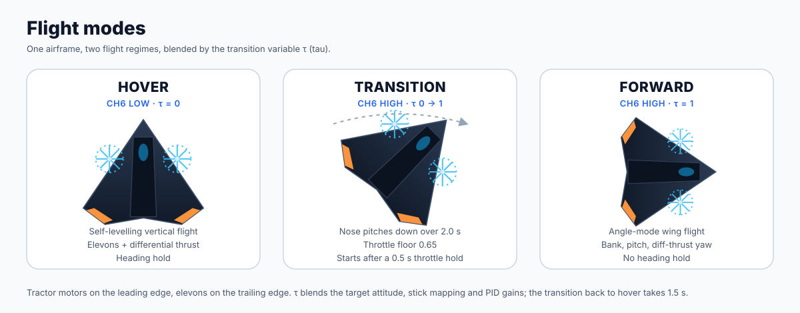
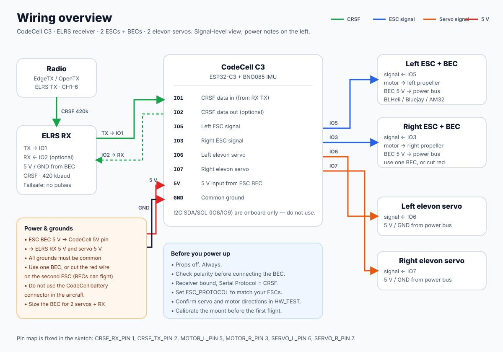

# Hardware

The controller expects a small flying wing with **two tractor motors on the leading edge**, **two elevons on the trailing edge**, and a **Microbots CodeCell C3** as the only flight computer. This page covers the bill of materials, the airframe layout, the pin map, wiring, power and receiver setup.

> [!WARNING]
> Remove both propellers before wiring, calibrating, flashing or running any bench test.

## Bill of materials

| Part | Quantity | Notes |
|---|---|---|
| Microbots CodeCell C3 | 1 | ESP32-C3 + BNO085 IMU. The flight controller. |
| Brushless motors | 2 | Small outrunners sized for the wing. Counter-rotating props. |
| ESCs | 2 | One per motor. PWM, OneShot, Multishot or DShot. |
| Props | 2 | Counter-rotating pair, matched to the motors. |
| Elevon servos | 2 | 5–9 g class is typical for a small wing. |
| Flying wing airframe | 1 | Two elevons, motors on the leading edge. |
| ExpressLRS receiver | 1 | CRSF output at 420 kbaud. |
| Battery | 1 | 2S–4S, matched to motors, ESCs and BEC. |
| Tail skids / bumper | 1 set | Protects the elevons when the aircraft stands on its tail. |
| Foam tape / standoffs | — | Vibration isolation for the CodeCell. |

## Airframe layout

<div align="center">
  
</div>

- **Motors on the leading edge (front).** Both motors are mounted on the front of the wing, one per side, in a tractor layout. The props pull the aircraft. When the aircraft stands on its tail, the props are at the top and the elevons are at the bottom.
- **Elevons on the trailing edge (rear).** Left elevon on IO6, right elevon on IO7. They provide forward roll/pitch and hover yaw/pitch through the mixer.
- **Counter-rotating props.** Use one normal and one reverse prop. This cancels prop torque in hover and makes differential-thrust yaw predictable.
- **Symmetric thrust line.** Keep both motors the same distance from the centreline and at the same height. A large left/right asymmetry shows up as a hover trim error.
- **Tail skids.** The aircraft stands on its tail. Add two small skids or a bumper so the elevons and servo linkages are not the landing gear.
- **CG.** Balance the wing near the aerodynamic centre recommended by the airframe designer. The tail-sitter does not need a special CG, but a very tail-heavy wing will be hard to hover.
- **Rigid IMU mount.** Foam-tape the CodeCell to the airframe, away from ESC heat and prop wash. A loose board produces gyro noise and a drifting attitude estimate.

The CodeCell can be mounted in **any orientation**. The two-pose calibration learns the sensor-to-body rotation, so you do not need to align the board with the wing. See [CALIBRATION.md](CALIBRATION.md).

## Pin map

The pin map is fixed in `TailSitter.ino`.

| CodeCell pin | Direction | Function |
|---|---|---|
| **IO1** | input | CRSF data from the receiver TX |
| **IO2** | output | CRSF data to the receiver RX (optional) |
| **IO5** | output | Left ESC signal |
| **IO3** | output | Right ESC signal |
| **IO6** | output | Left elevon servo |
| **IO7** | output | Right elevon servo |
| **5V** | power | 5 V input from the ESC BEC |
| **GND** | power | Common ground |
| IO8 / IO9 | — | Onboard I2C (BNO085). Do not use. |

> The motor pins are **not** in left/right order: left is IO5 and right is IO3. Follow the table, not the numeric order.

## Wiring

<div align="center">
  
</div>

### Receiver (CRSF)

| Receiver | CodeCell |
|---|---|
| TX | IO1 |
| RX | IO2 (optional) |
| 5 V | BEC 5 V |
| GND | Common ground |

- Set the receiver to **CRSF** at **420 kbaud** (the ExpressLRS default).
- The radio must be on and linked; an unlinked ELRS receiver sends nothing.
- Configure the receiver failsafe to **no pulses**. The built-in CRSF parser cannot see a "hold" failsafe bit, so a receiver that holds stale values can defeat the link-loss detector. See [SAFETY.md](SAFETY.md).
- Keep the receiver antenna away from the ESCs and battery leads.

### ESCs

| ESC | CodeCell | Motor |
|---|---|---|
| Left signal | IO5 | Left motor |
| Right signal | IO3 | Right motor |
| BEC 5 V | CodeCell 5V | — |
| BEC GND | Common ground | — |

- The ESC signal inputs are driven at **3.3 V logic**, which is compatible with normal ESC inputs.
- **Use one BEC, or cut the red wire on the second ESC.** Two linear BECs tied together can fight and overheat. If both ESCs have BECs, disconnect the 5 V wire from one of them and keep its ground.
- Set the motor direction in the ESC configurator (BLHeli / Bluejay / AM32) or by swapping two motor wires. Do not rely on the flight code to reverse a motor.

### Elevon servos

| Servo | CodeCell |
|---|---|
| Left signal | IO6 |
| Right signal | IO7 |
| 5 V | BEC 5 V |
| GND | Common ground |

- Power the servos from the **BEC 5 V bus**, not from a GPIO.
- Check the servo direction in `HW_TEST` before flight. `SERVO_REV_L` and `SERVO_REV_R` in the sketch set the direction; the defaults assume the left elevon moves up for a positive command and the right elevon is reversed.
- Set the servo centres and throws mechanically where possible. `SERVO_CENTER_L/R`, `SERVO_THROW_US`, `SERVO_MIN_US` and `SERVO_MAX_US` are the software limits.

### Power and grounding

```
ESC BEC 5 V ──┬── CodeCell 5V
              ├── ELRS receiver 5 V
              └── servo 5 V
All grounds ──┴── common
```

- **Do not use the CodeCell battery connector in the aircraft.** Power the CodeCell from the 5 V pin.
- **All grounds must be common.** A missing ground is the most common cause of a receiver that "works on the bench" but not in the air.
- Size the BEC for **two servos plus the receiver**. A small BEC that browns out under servo load will reset the ESP32-C3 in flight. If in doubt, use a separate 5 V UBEC rated for at least 3 A.
- Add a low-ESR capacitor across the 5 V bus near the ESCs if your ESCs do not already have one.
- Keep the battery leads and servo leads away from the receiver antenna and the IMU.

## ESC protocol

Set `ESC_PROTOCOL` to match your ESCs.

| `ESC_PROTOCOL` | Protocol | Notes |
|---|---|---|
| `0` | PWM | 1000–2000 µs at `ESC_PWM_HZ` (default 400 Hz; use 50 Hz for old ESCs) |
| `1` | DShot (RMT hardware) | Digital, no throttle calibration. `DSHOT_SPEED` 150 / 300 / 600 |
| `2` | DShot (software timing) | Same speeds; fallback if RMT is unavailable |
| `3` | OneShot125 | 125–250 µs at 2 kHz |
| `4` | OneShot42 | 42–84 µs at 8 kHz |
| `5` | Multishot | 5–25 µs at 32 kHz |

- The shipped default is **`3` (OneShot125)**. Change it to match your ESCs before the first flight.
- **DShot needs no throttle calibration.** Analog protocols (`0`, `3`, `4`, `5`) may need the `ESC_CAL 1` procedure; see [BUILD.md](BUILD.md).
- The throttle range is always expressed on the 1000–2000 µs scale in the sketch, then scaled to the selected protocol.

## Receiver and radio setup

| Channel | Function | Notes |
|---|---|---|
| CH1 | Roll | Hover: lean left/right. Forward: bank. |
| CH2 | Pitch | Hover: lean forward/back. Forward: pitch. |
| CH3 | Throttle | Hover: collective. Forward: thrust. |
| CH4 | Yaw | Hover: rotate about vertical. Forward: differential-thrust yaw. |
| CH5 | Arm / disarm | High = arm, low = disarm. |
| CH6 | Flight mode | Low = vertical / tail-sitter, high = forward / plane. |

- Use a **simple 4-channel + 2 aux** model. Do **not** add elevon or delta mixing in the radio; the flight controller does all the mixing.
- Set endpoints to approximately **1000–2000 µs** and centre to **1500 µs**.
- Set the throttle trim low enough that the stick reads below `ARM_MAX_THR` (0.05) when fully down.
- `RC_REV_PITCH` is `true` by default because EdgeTX/OpenTX mode-2 radios send a low value when the elevator stick is pulled back. Verify the direction in `HW_TEST`.
- CH5 must be cycled **low → high** before each arm attempt.
- CH6 must be **low** to arm; the forward transition is blocked while CH6 is high.

## First power-up checklist

With **props off**:

1. Inspect the wiring for polarity and a common ground.
2. Confirm one BEC only, or the red wire cut on the second ESC.
3. Power the radio first, then the aircraft.
4. Confirm the receiver links and the LED goes green (disarmed).
5. Run `RX_TEST` if the receiver does not link; see [TROUBLESHOOTING.md](TROUBLESHOOTING.md).
6. Run `HW_TEST` to check servo directions, motor order and motor direction.
7. Run `IMU_TEST` if the attitude estimate looks wrong.
8. Calibrate the mount per [CALIBRATION.md](CALIBRATION.md).
9. Only then fit the props and follow [FLIGHT.md](FLIGHT.md).

---

Next: **[BUILD.md](BUILD.md)** · **[CALIBRATION.md](CALIBRATION.md)** · **[SAFETY.md](SAFETY.md)**
